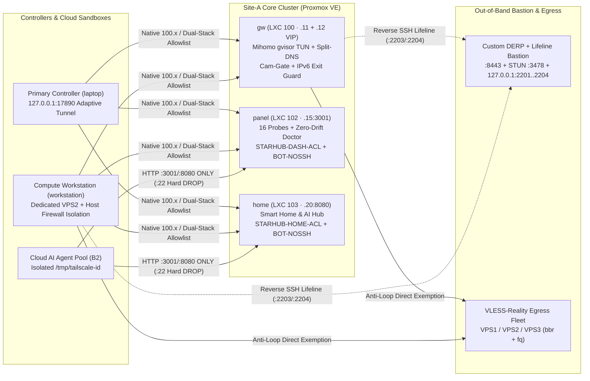

# StarHub Kit (`starhub-kit`)

[](https://www.bestpractices.dev/projects/16658)
[](https://scorecard.dev/viewer/?uri=github.com/Ziqi/starhub-kit)
[](https://github.com/Ziqi/starhub-kit/attestations)
[](https://opensource.org/licenses/MIT)

> **Language**: **English** | [简体中文 (Simplified Chinese)](./README.zh-CN.md)  
> **Version**: `v1.2.0` · **Runtime**: Python 3.9+ (Zero Third-Party Dependencies) · **Nix**: [`flake.nix`](./flake.nix) · **Assurance**: [OpenSSF Silver (`#16658`)](https://www.bestpractices.dev/projects/16658) + [OSPS Baseline L3](./SECURITY.md#6-openssf-osps-baseline-level-3-alignment--reproducible-builds)

**StarHub Kit** is a zero-dependency declarative compiler for **multi-site Tailscale `100.x + 4via6` mesh routing, deterministic Mihomo (`Clash Meta`) split-DNS & precision QUIC governance, cloud AI sandbox dual-stack firewalls, and out-of-band SSH lifelines**.

Edit one machine-readable topology file ([STARHUB_GROUND_TRUTH.json](./STARHUB_GROUND_TRUTH.json)) and run `./bin/starhub render` to deterministically compile dual-stack `iptables`/`ip6tables` allowlists, split-DNS/QUIC proxy rulesets, restricted guest sandbox bootstraps, IoT camera kernel kill-switches, and reverse-SSH `systemd` lifelines—verified by an 8-dimension zero-drift & zero-PII harness.



### Try in 10 Seconds (Zero Root, Zero Disk Writes)

```bash
# Option A — One-command install via official Homebrew tap (macOS & Linuxbrew)
brew install Ziqi/tap/starhub-kit
starhub render --profile minimal --only mihomo --dry-run

# Option B — Clone & preview modular Mihomo or AI-sandbox rules directly to stdout (no root required)
git clone https://github.com/Ziqi/starhub-kit.git && cd starhub-kit
./bin/starhub render --profile minimal --only mihomo --dry-run
./bin/starhub render --only ai-sandbox --dry-run

# Option C — Run directly via Nix Flake without cloning
nix run github:Ziqi/starhub-kit -- render --profile minimal --only mihomo --dry-run
```

---

## Why StarHub Kit? (4 Real-World Infrastructure Pain Points Solved)

| Pain Point in Typical Homelab / Multi-Site Setups | StarHub Declarative Engineering Architecture |
|---|---|
| **1. Hotel / Coffee-Shop Wi-Fi Subnet Collisions**<br/>Advertising raw `/24` or `/32` RFC 1918 LAN routes over Tailscale breaks local gateway routing whenever remote Wi-Fi shares the same LAN prefix. | **Zero-Collision Native `100.x` + `4via6`**<br/>Containers run native `tailscale0` (`100.64.0.0/10`); non-Tailscale hypervisors use Tailscale `4via6` IPv6 translation (`2001:db8:4a6::10` pattern) with `STARHUB-IPV6-EXIT-GUARD` blocking IPv6 leaks. |
| **2. Cross-Border Proxy Stalls & QUIC Blackholes**<br/>Blind DNS `fallback:` racing causes hundreds of half-open TLS `context canceled` drops per day; Apple Media DRM and mobile Gmail inline attachments hang 50s on dead XUDP `UDP/443`, while global `UDP/443 REJECT` breaks YouTube Cronet subtitles. | **Deterministic Split-DNS + Top-Ordered (`Section 9a`) QUIC Governance**<br/>Zero `fallback:` racing (`nameserver-policy` only) + top-ordered surgical `UDP/443 REJECT` for Apple Media and mobile Gmail/attachment endpoints (placed above broad Google proxy rules), with automated YouTube Cronet zero-collateral assertions. |
| **3. Cloud AI Agent Split-Brain & Lateral Movement Risk**<br/>Multiple cloud AI sandboxes sharing a Tailscale state file collide on `NodeKey`/`HomeDERP`, or gain dangerous `:22` SSH / Docker access to internal hosts. | **Restricted Cloud Sandbox Guest Pass (`B2` Pattern)**<br/>Per-instance `/tmp/tailscale-<id>` isolation (`agent-tailscale-bootstrap.sh`) + dual-stack `STARHUB-BOT-NOSSH` / `NOSSH6` chains that allow Web APIs (`:3001`/`:8080`) while hard-dropping TCP `:22` SSH. |
| **4. Documentation Sprawl, Drift & Accidental PII / Inventory Leaks**<br/>Dozens of stale `.md` files contradict live firewall/proxy configs, and AI coding agents hallucinate retired IPs or leak personal hardware inventory when open-sourcing. | **Unified Governance (`EGM 3.0`: `1 Core + 6 Books + 2 Ledgers`)**<br/>Unified `AGENTS.md` (`CLAUDE.md` / `GROK.md` symlinks), strict Markdown whitelist, compiler parity gate (`render --check`), and a mathematical Zero-PII & Zero-Inventory Release Sanitizer (`--verify-public-export`). |

---

## Architecture Overview



---

## Choose Your Adoption Tier (30 Seconds to Full Blueprint)

You do **not** need Proxmox VE, dedicated observability hosts, or three overseas relays to benefit from StarHub Kit. Choose the tier or modular slice (`--only mihomo|firewall|ai-sandbox|lifeline`) that fits your setup (see [docs/ARCHITECTURE-AND-PLAYBOOK-EN.md](./docs/ARCHITECTURE-AND-PLAYBOOK-EN.md)):

| Tier | Hardware Needed | Setup Time | How to Use |
|---|---|---|---|
| **Tier 0 · Drop-In Ruleset** | Any existing **OpenWrt / Clash Verge / Mihomo Party / Stash + Tailscale** setup | **30 seconds** (Zero Python) | Copy `dns:` and `rules:` from [`scripts/profiles/standalone-mihomo-tailscale-guardrails.yaml`](./scripts/profiles/standalone-mihomo-tailscale-guardrails.yaml) directly into your `config.yaml` |
| **Tier 1 · StarHub Lite (`minimal`)** | **1 Gateway** + **1 Laptop/PC** + **1 Egress** (no PVE, no custom DERP, no extra VMs) | **3 minutes** | Edit 3 items in [`profiles/topology.minimal.json`](./profiles/topology.minimal.json) and run `./bin/starhub render --profile minimal --out-dir ./dist-minimal` (or preview with `--dry-run`) |
| **Tier 2 · Full Blueprint (`full`)** | Multi-site mesh + isolated compute workstation + cloud AI sandboxes + IoT camera kill-switch | **15 minutes** | `./bin/starhub init && ./bin/starhub render --out-dir ./dist` ([`topology.example.json`](./topology.example.json)) |

---

## 3-Minute Full Workflow

```bash
# 1. Initialize STARHUB_GROUND_TRUTH.json (full or --profile minimal)
./bin/starhub init

# 2. Preview individual subsystems to stdout (zero disk writes) or export a deployment bundle
./bin/starhub render --only firewall --dry-run
./bin/starhub render --out-dir ./dist

# 3. Run the 7-dimension static harness, bit-for-bit reproducible archive gate & 2,000-iteration fuzz suite
./bin/starhub render --check
./bin/starhub archive --verify
./bin/starhub doctor --local-docs-only
python3 ./tests/fuzz_starhub_ctl.py --iterations 2000

# 4. Install the Git pre-commit guardrail
cp scripts/pre-commit .git/hooks/pre-commit && chmod +x .git/hooks/pre-commit
```

---

## Repository Structure (`1 Core + 6 Books + 2 Ledgers`)

| Path | Description |
|---|---|
| [STARHUB_GROUND_TRUTH.json](./STARHUB_GROUND_TRUTH.json) / [topology.example.json](./topology.example.json) / [profiles/topology.minimal.json](./profiles/topology.minimal.json) | **Single Source of Truth (SSOT)**: role-based declarative node inventory, dual-stack allowlists, egress definitions, IoT guardrails, and Markdown whitelist |
| `./bin/starhub`, `scripts/starhub-ctl.py` & [flake.nix](./flake.nix) | **Declarative Compiler & Reproducible Builder**: modular `--only` / `--dry-run` compiler, bit-for-bit PAX tarball builder (`archive --verify`), and Nix Flake entrypoint |
| `scripts/starhub-doctor.py` | **Verification Harness**: 8-dimension drift detector + `--verify-public-export` Zero-PII & Zero-Inventory Release Sanitizer |
| [AGENTS.md](./AGENTS.md) (`CLAUDE.md` / `GROK.md` symlinks) | **Unified AI & Operator Entrypoint**: Ten Iron Guardrails and zero-hallucination workflow |
| [docs/01-架构与IP全景.md](./docs/01-架构与IP全景.md) – [docs/06-AI接力开发与Prompt手册.md](./docs/06-AI接力开发与Prompt手册.md) | **The 6 Golden Books**: Architecture, Daily Ops & Security Matrix, Troubleshooting & 1-Hour Bare-Metal DR, Audit Index, Smart Home Hub, and Multi-Agent Playbook |
| [docs/ROADMAP-v2.md](./docs/ROADMAP-v2.md) | **StarHub v2.0 Plugin Specification**: declarative `:3001` probe schema and `:8080` Home OS `drivers/*` plugin contract |
| [docs/ops/STARHUB-LEDGER.md](./docs/ops/STARHUB-LEDGER.md) & [docs/incidents/README.md](./docs/incidents/README.md) | **Dual Ledgers**: append-only `[UPD]/[BUGFIX]/[WORKSTATION]` master ledger and `5-Why` postmortem template |

---

## Dual-Repo Private/Public Workflow (Zero-PII & Zero-Inventory Sanitizer)

If you run a private production repository alongside a public fork of `starhub-kit`, verify mathematically before every public release that **zero** private IPs, Tailscale addresses, MACs, domains, handles, or private device/vendor identifiers exist anywhere in the public working tree or `.git` commit history:

```bash
python3 scripts/starhub-doctor.py \
  --verify-public-export /path/to/starhub-kit \
  --private-gt /path/to/private/STARHUB_GROUND_TRUTH.json
```

---

## Security, OSPS Baseline L3 & Supply-Chain Assurance

[](https://github.com/Ziqi/starhub-kit/attestations)
[](./SECURITY.md#6-openssf-osps-baseline-level-3-alignment--reproducible-builds)
[](https://github.com/Ziqi/starhub-kit/actions/workflows/ci.yml)
[](https://github.com/Ziqi/starhub-kit/actions/workflows/codeql.yml)
[](https://github.com/Ziqi/starhub-kit/releases/latest)
[](https://reuse.software/)
[](https://github.com/Ziqi/homebrew-tap)
[](https://archive.softwareheritage.org/swh:1:snp:e4eeb16e7cac5969e38072612578d061e9370e93)

Every release and `main` build publishes a **Sigstore + GitHub OIDC `SLSA Build Level 3` provenance certificate**, an **ISO/IEC 5962 (`SPDX-2.3`) SBOM**, a **bit-for-bit reproducible source archive (`mtime=0`, `uid/gid=0`)**, and an offline **Ed25519 signature**, audited under [OpenSSF Best Practices `Silver` (`#16658`)](https://www.bestpractices.dev/projects/16658) and aligned with [OpenSSF OSPS Baseline (Level 3)](./SECURITY.md#6-openssf-osps-baseline-level-3-alignment--reproducible-builds):

```bash
# 1. Verify GitHub OIDC / Sigstore SLSA Build Level 3 provenance certificate
gh attestation verify starhub-kit-v1.2.0.tar.gz --repo Ziqi/starhub-kit

# 2. Verify bit-for-bit reproducible tarball against source tag
./bin/starhub archive --verify-file ./starhub-kit-v1.2.0.tar.gz --prefix starhub-kit-v1.2.0
```

Released under the [MIT License](./LICENSE). Please review [GOVERNANCE.md](./GOVERNANCE.md), [CODE_OF_CONDUCT.md](./CODE_OF_CONDUCT.md), [CONTRIBUTING.md](./CONTRIBUTING.md), and [SECURITY.md](./SECURITY.md) before submitting a pull request.
