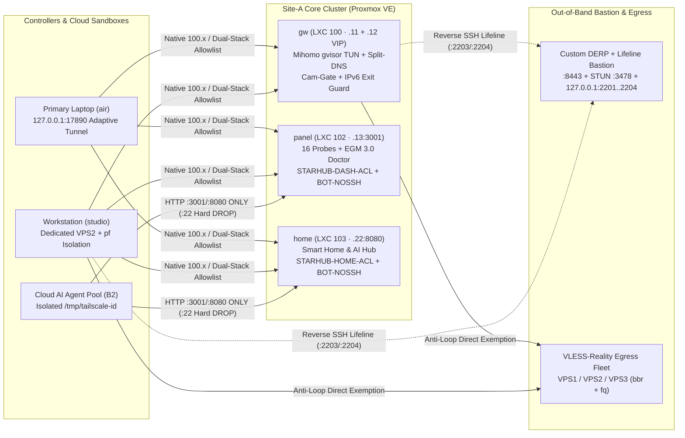

# StarHub Kit (`starhub-kit`)

[](https://opensource.org/licenses/MIT)
[](https://github.com/Ziqi/starhub-kit/actions/workflows/ci.yml)
[](https://github.com/Ziqi/starhub-kit/actions/workflows/codeql.yml)
[](https://github.com/Ziqi/starhub-kit/attestations)
[](https://github.com/Ziqi/starhub-kit/attestations)
[](https://scorecard.dev/viewer/?uri=github.com/Ziqi/starhub-kit)
[](https://github.com/Ziqi/starhub-kit/releases/latest)
[](https://reuse.software/)

> **Language**: **English** | [简体中文 (Simplified Chinese)](./README.zh-CN.md)  
> **Version**: `v1.0.2` · **License**: [MIT](./LICENSE) (`SPDX-2.3` / `REUSE 3.2`) · **Supply Chain**: Sigstore `SLSA Build Level 3` + Ed25519 Signed Releases · **Runtime**: Python 3.9+ (Zero Third-Party Dependencies)

**StarHub Kit** is a battle-tested, declarative **Multi-Site Mesh + Anti-Stall Transparent Gateway + Out-of-Band Lifeline + AI-Governed Infrastructure (`EGM 3.0`)** toolkit.

Edit a single machine-readable topology file ([STARHUB_GROUND_TRUTH.json](./STARHUB_GROUND_TRUTH.json)), run `./bin/starhub render`, and deterministically compile dual-stack `iptables`/`ip6tables` allowlists, Mihomo (`Clash Meta`) deterministic split-DNS & precision QUIC rulesets, cloud AI sandbox (`B2`) guest isolation scripts, IoT camera physical cloud kill-switches, and reverse-SSH out-of-band lifelines—backed by an 8-dimension zero-drift & zero-PII verification harness.

---

## Why StarHub Kit? (4 Real-World Infrastructure Pain Points Solved)

| Pain Point in Typical Homelab / Multi-Site Setups | StarHub 3.0 Battle-Tested Architecture |
|---|---|
| **1. Hotel / Coffee-Shop Wi-Fi Subnet Collisions**<br/>Advertising raw `/24` or `/32` RFC 1918 LAN routes over Tailscale breaks local gateway routing whenever remote Wi-Fi shares the same LAN prefix. | **Zero-Collision Native `100.x` + `4via6`**<br/>Containers run native `tailscale0` (`100.64.0.0/10`); non-Tailscale hypervisors use Tailscale `4via6` IPv6 translation (`2001:db8:4a6::10` pattern) with `STARHUB-IPV6-EXIT-GUARD` blocking IPv6 leaks. |
| **2. Cross-Border Proxy Stalls & QUIC Blackholes**<br/>Blind DNS `fallback:` racing causes hundreds of half-open TLS `context canceled` drops per day; Apple TV+ DRM and Gmail iOS hang 50s on dead XUDP `UDP/443`, while global `UDP/443 REJECT` breaks YouTube Cronet subtitles. | **Deterministic Split-DNS + Surgical QUIC Governance**<br/>Zero `fallback:` racing (`nameserver-policy` only) + surgical domain-scoped `UDP/443 REJECT` for Apple Media (`Section 12b`) and Gmail (`Section 12c`) with automated YouTube Cronet zero-collateral assertions. |
| **3. Cloud AI Agent Split-Brain & Lateral Movement Risk**<br/>Multiple cloud AI sandboxes sharing a Tailscale state file collide on `NodeKey`/`HomeDERP`, or gain dangerous `:22` SSH / Docker access to internal hosts. | **Cloud Agent `B2` Restricted Guest Pass**<br/>Per-instance `/tmp/tailscale-<id>` isolation (`grokbot-tailscale-bootstrap.sh`) + dual-stack `STARHUB-BOT-NOSSH` / `NOSSH6` chains that allow Web APIs (`:3001`/`:8080`) while hard-dropping TCP `:22` SSH. |
| **4. Documentation Sprawl, Drift & Accidental PII Leaks**<br/>Dozens of stale `.md` files contradict live firewall/proxy configs, and AI coding agents hallucinate retired IPs or leak personal topology when open-sourcing. | **StarHub EGM 3.0 (`1 Core + 6 Books + 2 Ledgers`)**<br/>Unified `AGENTS.md` (`CLAUDE.md` / `GROK.md` symlinks), strict Markdown whitelist, compiler parity gate (`render --check`), and a mathematical Zero-PII Release Sanitizer (`--verify-public-export`). |

---

## Architecture Overview



---

## 3-Minute Quickstart

```bash
# 1. Clone the repository and initialize your topology SSOT
git clone https://github.com/Ziqi/starhub-kit.git
cd starhub-kit
./bin/starhub init

# 2. Customize STARHUB_GROUND_TRUTH.json with your own nodes/IPs, then compile in-place
./bin/starhub render --in-place

# 3. Export a complete deployment bundle (firewalls, Mihomo skeleton, Cam-Gate, SSH drop-in, systemd Lifelines)
./bin/starhub render --out-dir ./dist

# 4. Run the 7-dimension static EGM 3.0 gate & 2,000-iteration fuzz suite (zero network calls)
./bin/starhub doctor --local-docs-only
python3 ./tests/fuzz_starhub_ctl.py --iterations 2000

# 5. Install the Git pre-commit guardrail
cp scripts/pre-commit .git/hooks/pre-commit && chmod +x .git/hooks/pre-commit
```

---

## Repository Structure (`1 Core + 6 Books + 2 Ledgers`)

| Path | Description |
|---|---|
| [STARHUB_GROUND_TRUTH.json](./STARHUB_GROUND_TRUTH.json) / [topology.example.json](./topology.example.json) | **Single Source of Truth (SSOT)**: declarative node inventory, dual-stack allowlists, egress VPS definitions, IoT guardrails, and Markdown whitelist |
| `./bin/starhub` & `scripts/starhub-ctl.py` | **Declarative Compiler**: renders dual-stack firewalls, `B2` sandbox bootstrap, Mihomo guardrails/skeleton, `cam-gate.sh`, `ssh_config.starhub`, and Lifeline `systemd` units |
| `scripts/starhub-doctor.py` | **StarHub EGM 3.0 Harness**: 8-dimension drift detector + `--verify-public-export` Zero-PII Release Sanitizer |
| [AGENTS.md](./AGENTS.md) (`CLAUDE.md` / `GROK.md` symlinks) | **Unified AI & Operator Entrypoint**: Ten Iron Guardrails and zero-hallucination workflow |
| [docs/01-架构与IP全景.md](./docs/01-架构与IP全景.md) – [docs/06-AI接力开发与Prompt手册.md](./docs/06-AI接力开发与Prompt手册.md) | **The 6 Golden Books**: Architecture, Daily Ops & Security Matrix, Troubleshooting & 1-Hour Bare-Metal DR, Audit Index, Smart Home Hub, and Multi-Agent Playbook |
| [docs/ROADMAP-v2.md](./docs/ROADMAP-v2.md) | **StarHub v2.0 Plugin Specification**: declarative `:3001` probe schema and `:8080` Home OS `drivers/*` plugin contract |
| [docs/ops/STARHUB-LEDGER.md](./docs/ops/STARHUB-LEDGER.md) & [docs/incidents/README.md](./docs/incidents/README.md) | **Dual Ledgers**: append-only `[UPD]/[BUGFIX]/[STUDIO]` master ledger and `5-Why` postmortem template |

---

## Dual-Repo Private/Public Workflow (Zero-PII Sanitizer)

If you run a private production repository alongside a public fork of `starhub-kit`, verify mathematically before every public release that **zero** private IPs, Tailscale addresses, MACs, domains, or handles exist anywhere in the public working tree or `.git` commit history:

```bash
python3 scripts/starhub-doctor.py \
  --verify-public-export /path/to/starhub-kit \
  --private-gt /path/to/private/STARHUB_GROUND_TRUTH.json
```

---

## Supply-Chain Verification & Governance

Every release and `main` build publishes a **Sigstore + GitHub OIDC `SLSA Build Level 3` provenance certificate**, an **ISO/IEC 5962 (`SPDX-2.3`) SBOM**, and an offline **Ed25519 signature**:

```bash
# Verify GitHub OIDC / Sigstore SLSA Build Level 3 provenance certificate
gh attestation verify starhub-kit-bundle.tar.gz --repo Ziqi/starhub-kit
```

Released under the [MIT License](./LICENSE). Please review [GOVERNANCE.md](./GOVERNANCE.md), [CODE_OF_CONDUCT.md](./CODE_OF_CONDUCT.md), [CONTRIBUTING.md](./CONTRIBUTING.md), and [SECURITY.md](./SECURITY.md) (including §5 Threat Model & Assurance Case) before submitting a pull request.
