# StarHub Kit 星枢开源套件 (`starhub-kit`)

[](https://www.bestpractices.dev/projects/16658)
[](https://scorecard.dev/viewer/?uri=github.com/Ziqi/starhub-kit)
[](https://github.com/Ziqi/starhub-kit/attestations)
[](https://opensource.org/licenses/MIT)

> **语言切换 (Language)**：[English](./README.md) | **简体中文**  
> **版本**：`v1.2.0` · **运行依赖**：Python 3.9+ 标准库（零第三方依赖） · **Nix 入口**：[`flake.nix`](./flake.nix) · **权威认证**：[OpenSSF `Silver` 银牌（`#16658`）](https://www.bestpractices.dev/projects/16658) + [OSPS Baseline L3](./SECURITY.md#6-openssf-osps-baseline-level-3-alignment--reproducible-builds)

**StarHub Kit（星枢开源套件）** 是一套零第三方依赖的**声明式多站点 Tailscale `100.x + 4via6` 零撞段组网、Mihomo（`Clash Meta`）确定性分域 DNS 与精细化 QUIC 治理、云端 AI 沙箱双栈白名单防火墙及带外 SSH 救生通道编译器**。

只需维护一份机器可读拓扑事实源 [STARHUB_GROUND_TRUTH.json](./STARHUB_GROUND_TRUTH.json)，执行 `./bin/starhub render`，即可确定性编译双栈 `iptables`/`ip6tables` 防火墙、分域 DNS 与精确 QUIC 规则集、受限云端沙箱引导脚本、物联网摄像头网关级物理断云开关与反向 SSH `systemd` 服务——底层内置 8 维度零配置漂移与数学级反隐私泄露门禁。



### 10 秒免安装 / 无特权预览体验（零写盘、无需 Root）

```bash
# 方式一：通过官方 Homebrew Tap 一键安装（macOS 与 Linuxbrew 通用）
brew install Ziqi/tap/starhub-kit
starhub render --profile minimal --only mihomo --dry-run

# 方式二：克隆后直接在终端预览单个子模块（如仅看 Mihomo 分流或 AI 沙箱防火墙，0 文件写入）
git clone https://github.com/Ziqi/starhub-kit.git && cd starhub-kit
./bin/starhub render --profile minimal --only mihomo --dry-run
./bin/starhub render --only ai-sandbox --dry-run

# 方式三：通过 Nix Flake 免克隆单行直接运行
nix run github:Ziqi/starhub-kit -- render --profile minimal --only mihomo --dry-run
```

---

## 为什么需要 StarHub Kit？（直击四大实战深水区痛点）

| 传统家庭实验室 / 跨地域组网痛点 | 星枢声明式工程解法 |
|---|---|
| **1. 出门连酒店/咖啡厅 Wi-Fi 内网撞段失联**<br/>传统子网路由在异地同名 `/24` 局域网下会触发内核路由优先级抢占，导致网关与容器瞬间断联。 | **原生 `100.x` + `4via6` 零撞段架构**<br/>核心容器直通 `/dev/net/tun` 启用原生 `100.64.0.0/10`；不便装客户端的宿主机通过 `4via6` 纯 IPv6 映射访问，配合 `STARHUB-IPV6-EXIT-GUARD` 杜绝双栈泄漏。 |
| **2. 透明网关跨洋半开断流与移动端 QUIC 黑洞**<br/>盲目配置 DNS `fallback:` 双发竞速导致日均数百次 `context canceled`；Apple 流媒体与移动端 Gmail 内嵌图片/附件因跨境 XUDP `UDP/443` 黑洞干等 50s，而粗暴封杀全局 `UDP/443` 又会误伤 YouTube Cronet 字幕。 | **确定性分域 DNS + 顶层前置（`Section 9a`）手术刀级 QUIC 治理**<br/>彻底移除 `fallback:` 竞速（纯 `nameserver-policy` 确定性路由），在广义 Google 代理规则上方精确拦截 Apple 媒体与 Gmail/附件域名 `UDP/443`，并由 `doctor` 自动校验零误伤 YouTube Cronet。 |
| **3. 云端 AI 沙箱撞号失步与内网横向渗透风险**<br/>多实例云端 Agent 共用 Tailscale 状态文件会引发 `NodeKey` 抢占断流；若直接放通内网更会暴露 `:22` SSH 与容器管理口。 | **云端沙箱受限访客通行证（`B2` 隔离模式）**<br/>通过 `agent-tailscale-bootstrap.sh` 按实例隔离 `/tmp/tailscale-<id>`，双栈防火墙 `STARHUB-BOT-NOSSH` / `NOSSH6` 仅放行 `:3001`/`:8080` Web API，硬件级 `DROP` 全部 `:22` SSH。 |
| **4. 运维文档腐败膨胀、配置漂移与资产指纹泄露风险**<br/>几十份历史 Markdown 互相打架，AI 助手反复读取旧 IP 产生幻觉；想开源架构又担心泄露真实 IP、服务商与个人硬件设备清单。 | **统一工程治理（`EGM 3.0`：「1 核 + 6 册 + 2 账」）**<br/>根部 `AGENTS.md`（`CLAUDE.md`/`GROK.md` 软链归一）、全角色化中立拓扑、`render --check` 零漂移校验，以及扫描工作树与 `.git` 全历史的 `--verify-public-export` 数学级反泄露门禁。 |

---

## 三级渐进接入指南（支持 `--only` 子模块按需裁剪）

您**不需要**拥有 Proxmox 虚拟化集群、独立监控机或三台海外 VPS 也能直接使用本套件（英文协议深潜速查见 [docs/ARCHITECTURE-AND-PLAYBOOK-EN.md](./docs/ARCHITECTURE-AND-PLAYBOOK-EN.md)）：

| 接入层级 | 所需设备门槛 | 上手耗时 | 使用方式 |
|---|---|---|---|
| **Tier 0 · 免编译即贴即用包** | 任何现成的 **OpenWrt / Clash Verge / Mihomo Party / Stash + Tailscale** 用户 | **30 秒**（零代码） | 直接复制 [`scripts/profiles/standalone-mihomo-tailscale-guardrails.yaml`](./scripts/profiles/standalone-mihomo-tailscale-guardrails.yaml) 中的 `dns:` 与 `rules:` 段粘贴至现有配置 |
| **Tier 1 · 单网关轻量版 (`minimal`)** | 仅需 **1 台旁路由/Mini主机 + 1 台电脑 + 1 个出口**（无需 PVE、无需自建 DERP） | **3 分钟** | 修改 [`profiles/topology.minimal.json`](./profiles/topology.minimal.json) 三个核心字段，执行 `./bin/starhub render --profile minimal --out-dir ./dist-minimal`（或加 `--dry-run` 预览） |
| **Tier 2 · 全栈参考蓝本 (`full`)** | 跨城多站点 + 独立算力工作站单向隔离 + 云端 AI 沙箱 + 摄像头物理断云闸 | **15 分钟** | 执行 `./bin/starhub init && ./bin/starhub render --out-dir ./dist`（支持 `--only firewall\|mihomo\|ai-sandbox\|lifeline` 按需输出） |

---

## 3 分钟完整研发与校验流（Quickstart）

```bash
# 1. 初始化您的唯一拓扑事实源（支持默认 full 或 --profile minimal）
./bin/starhub init

# 2. 按模块无特权预览（--dry-run）或导出完整可部署目录
./bin/starhub render --only firewall --dry-run
./bin/starhub render --out-dir ./dist

# 3. 运行零漂移校验、逐比特可重现归档门禁与 2,000 轮编译器模糊测试（零网络请求）
./bin/starhub render --check
./bin/starhub archive --verify
./bin/starhub doctor --local-docs-only
python3 ./tests/fuzz_starhub_ctl.py --iterations 2000

# 4. 安装 Git 提交前自动门禁钩子
cp scripts/pre-commit .git/hooks/pre-commit && chmod +x .git/hooks/pre-commit
```

---

## 「1 核 + 6 册 + 2 账」工程目录导航

1. **机器事实核**：[STARHUB_GROUND_TRUTH.json](./STARHUB_GROUND_TRUTH.json)（示例母版 [topology.example.json](./topology.example.json) · 单网关极简母版 [profiles/topology.minimal.json](./profiles/topology.minimal.json)）
2. **声明式编译器与 Nix 入口**：`./bin/starhub`、`scripts/starhub-ctl.py` 与 [flake.nix](./flake.nix)
3. **统一 AI 与人工总入口**：[AGENTS.md](./AGENTS.md)（`CLAUDE.md` 与 `GROK.md` 均为指向它的 POSIX 软链接）
4. **黄金六册蓝图手册**：
   - [docs/01-架构与IP全景.md](./docs/01-架构与IP全景.md) —— 零撞段拓扑、分域 DNS、`Section 9a` 精确 QUIC 治理与三出口架构
   - [docs/02-日常运维与变更升级.md](./docs/02-日常运维与变更升级.md) —— 十大铁律、常驻服务地图、凭据 `0600` 与单向受控矩阵、标准变更 SOP
   - [docs/03-排障与急救手册.md](./docs/03-排障与急救手册.md) —— 30 秒诊断树、四路救命绳（`:2201~:2204`）与 **1 小时裸机灾难重建（DR）**
   - [docs/04-日志与审计索引.md](./docs/04-日志与审计索引.md) —— 全链路日志定位、双台账规范与编译器映射表
   - [docs/05-智能家居与AI中枢全景.md](./docs/05-智能家居与AI中枢全景.md) —— 摄像头网关物理断云闸、Android TV 不断网软待机与分应用代理守则
   - [docs/06-AI接力开发与Prompt手册.md](./docs/06-AI接力开发与Prompt手册.md) —— 多智能体协同宪章（CLI + `tmux` / 云端 `B2` / 移动端 SSH/Mosh）与扩展蓝图
5. **`v2.0` 插件化演进规范**：[docs/ROADMAP-v2.md](./docs/ROADMAP-v2.md)（定义 `:3001` 看板动态探针与 `:8080` `Home OS` 硬件驱动插件接口契约）
6. **唯一双台账**：[docs/ops/STARHUB-LEDGER.md](./docs/ops/STARHUB-LEDGER.md) 与 [docs/incidents/README.md](./docs/incidents/README.md)（含标准 `5-Why` 复盘模板 [_template.md](./docs/incidents/_template.md)）

---

## 安全合规、OSPS Baseline L3 与可重现构建验真

[](https://github.com/Ziqi/starhub-kit/attestations)
[](./SECURITY.md#6-openssf-osps-baseline-level-3-alignment--reproducible-builds)
[](https://github.com/Ziqi/starhub-kit/actions/workflows/ci.yml)
[](https://github.com/Ziqi/starhub-kit/actions/workflows/codeql.yml)
[](https://github.com/Ziqi/starhub-kit/releases/latest)
[](https://reuse.software/)
[](https://github.com/Ziqi/homebrew-tap)
[](https://archive.softwareheritage.org/swh:1:snp:e4eeb16e7cac5969e38072612578d061e9370e93)

本项目已获颁 **[OpenSSF Best Practices `Silver`（银牌 · `#16658`）](https://www.bestpractices.dev/projects/16658)** 认证并全面对齐 **[OpenSSF OSPS Baseline (Level 3)](./SECURITY.md#6-openssf-osps-baseline-level-3-alignment--reproducible-builds)**，每次发布均自动签发 **Sigstore + GitHub OIDC `SLSA Build Level 3` 溯源证书**、**ISO/IEC 5962 (`SPDX-2.3`) SBOM**、**逐比特确定性可重现源码包（`mtime=0`, `uid/gid=0`）** 与 **Ed25519 离线数字签名**：

```bash
# 1. 一键验真 GitHub OIDC / Sigstore SLSA Build Level 3 密码学构建溯源证书
gh attestation verify starhub-kit-v1.2.0.tar.gz --repo Ziqi/starhub-kit

# 2. 离线复核源码归档包的逐比特可重现性（Bit-for-Bit Reproducible Builds）
./bin/starhub archive --verify-file ./starhub-kit-v1.2.0.tar.gz --prefix starhub-kit-v1.2.0
```

本项目基于 [MIT License](./LICENSE) 协议开源。提交 PR 前请先阅读 [GOVERNANCE.md](./GOVERNANCE.md)、[CODE_OF_CONDUCT.md](./CODE_OF_CONDUCT.md)、[CONTRIBUTING.md](./CONTRIBUTING.md) 与 [SECURITY.md](./SECURITY.md)。
