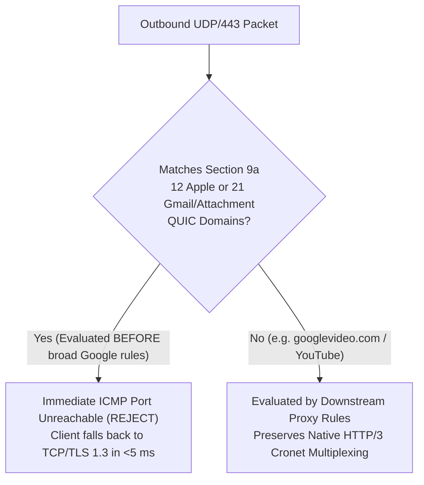

# StarHub Kit Architecture & Protocol Playbook (English)

> **Version**: `StarHub Kit v1.3.0` · **Companion Docs**: [README.md](../README.md) · [README.zh-CN.md](../README.zh-CN.md) · [SECURITY.md](../SECURITY.md)

This playbook distills the core protocol engineering, firewall invariants, and progressive deployment tiers behind **StarHub Kit** for international homelab operators, network engineers, and AI infrastructure builders.

---

## 1. Three Progressive Adoption Tiers

You do **not** need a Proxmox cluster, dedicated observability nodes, or three overseas VPS relays to use StarHub Kit. Pick the tier that matches your hardware:

| Tier | Target Setup | Time to Deploy | Entrypoint |
| :--- | :--- | :--- | :--- |
| **Tier 0 · Drop-In Ruleset** | Any existing **OpenWrt / Clash Verge / Mihomo Party / Stash + Tailscale** setup | **30 seconds** (Zero Python) | Copy sections from [`scripts/profiles/standalone-mihomo-tailscale-guardrails.yaml`](../scripts/profiles/standalone-mihomo-tailscale-guardrails.yaml) into your `config.yaml` |
| **Tier 1 · StarHub Lite (`minimal`)** | **1 Gateway** (Linux LXC / Mini-PC) + **1 Controller** (`laptop`) + **1 Egress** (`vps1`) | **3 minutes** | `./bin/starhub render --profile minimal --out-dir ./dist-minimal` (edit [`profiles/topology.minimal.json`](../profiles/topology.minimal.json)) |
| **Tier 2 · Full Reference Blueprint** | Multi-site mesh + isolated compute workstation + cloud AI `B2` sandboxes + IoT kill-switch + 4-way SSH lifelines | **15 minutes** | `./bin/starhub init && ./bin/starhub render --out-dir ./dist` ([`topology.example.json`](../topology.example.json)) |

---

## 2. Protocol Deep Dive #1: Breaking the Tailscale × Fake-IP Loop & DNS Races

Running Tailscale alongside a Fake-IP transparent gateway (`198.18.0.0/16`, `tun: gvisor`) triggers three classic failure modes if left unguarded:

1. **Fake-IP Hijacking of Tailscale Control & DERP Relays**:
   - If `*.tailscale.com`, `*.ts.net`, STUN (`UDP/3478`), or your egress server IP resolves to a `198.18.x.x` Fake-IP or enters the proxy tunnel, WireGuard handshakes recurse into the proxy tunnel itself and collapse.
   - **Fix**: Pin `+.ts.net` to `100.100.100.100#tailscale0` in `nameserver-policy` and place `DST-PORT,3478,DIRECT`, `DOMAIN-SUFFIX,tailscale.com,DIRECT`, `DOMAIN-SUFFIX,ts.net,DIRECT`, `IP-CIDR,100.64.0.0/10,DIRECT,no-resolve`, and egress `/32` exemptions at the very top of `rules:`.
2. **Eliminating Blind `fallback:` DNS Racing**:
   - Many community Clash templates configure both domestic and overseas resolvers under `nameserver:` + `fallback:`. Under cross-border jitter, slow responses trigger hundreds of `context canceled` half-open sockets per day and poison domestic CDN GeoIP locality.
   - **Fix**: Remove `fallback:` completely. Enforce `respect-rules: true` with deterministic `nameserver-policy` (`geosite:cn,private` -> domestic DoH; `geosite:geolocation-!cn` -> overseas DoH routed explicitly over `#EgressPrimary`).
3. **Zero-Collision `100.x` + `4via6` & TCP MSS Clamping**:
   - Advertising RFC 1918 `/24` LAN routes over Tailscale breaks local Wi-Fi routing whenever a hotel or coffee-shop network uses the same subnet. StarHub uses native `100.64.0.0/10` on containers and Tailscale `4via6` (`fd7a:115c:a1e0::/48`) for non-Tailscale appliances, paired with `iptables -t mangle ... -j TCPMSS --clamp-mss-to-pmtu` and `STARHUB-IPV6-EXIT-GUARD` (`starhub-ts-mss-clamp.sh`) so encapsulated frames never stall on PMTU blackholes or leak native IPv6.

---

## 3. Protocol Deep Dive #2: Surgical `Section 9a` QUIC (`UDP/443`) Governance

Cross-border VLESS/XUDP tunnels frequently experience asymmetric packet loss or middlebox throttling on long-lived `UDP/443` QUIC flows—yet handling `UDP/443` naively creates a painful dilemma:

- **If you allow all `UDP/443` through Fake-IP proxy tunnels**: Apple Media (`tv.apple.com`, `mzstatic.com`) and **mobile Gmail inline images & attachments** (`mail-attachment.googleusercontent.com`, `ci3~6.googleusercontent.com`, `lh3~6.googleusercontent.com`, `robinfrontend-pa.googleapis.com`) stall for 30–50 seconds waiting on dead QUIC streams before timing out.
- **If you globally `REJECT` all `UDP/443`**: YouTube's Cronet engine (`youtube.com`, `googlevideo.com`, `youtubei.googleapis.com`) loses native `HTTP/3` multiplexing and suffers caption/abr stalls on smart TVs.

### The StarHub `Section 9a` Solution & Rule-Ordering Invariant



> **Critical Ordering Guardrail**: `AND,((NETWORK,UDP),(DST-PORT,443),(DOMAIN,ci3.googleusercontent.com)),REJECT` **must** appear strictly **above** any broad `DOMAIN-SUFFIX,googleapis.com,PROXY`, `DOMAIN-SUFFIX,googleusercontent.com,PROXY`, or `GEOSITE,google,PROXY` rule. In first-match rule engines, placing `Section 9a` below wildcard Google rules shadows the `REJECT` rule and silently re-introduces mobile Gmail attachment stalls. `starhub-doctor.py` enforces both presence (`12/12` Apple + `21/21` Gmail) and zero YouTube Cronet collateral damage on every commit.

---

## 4. Security Deep Dive #3: Cloud AI Sandbox (`B2`) & Workstation Isolation

When granting autonomous AI coding agents or cloud sandboxes access to homelab telemetry, trusting flat VPN peer connectivity is dangerous:

1. **Per-Instance Userspace State Isolation (`scripts/agent-tailscale-bootstrap.sh`)**:
   - Ephemeral cloud sandboxes isolate `--statedir=/tmp/tailscale-<instance_id>` and run `--tun=userspace-networking` exposing a local SOCKS5/HTTP proxy on `127.0.0.1:1055`, preventing `NodeKey` split-brain across concurrent agent workers.
2. **Dual-Stack `STARHUB-BOT-NOSSH` / `NOSSH6` Hard-DROP**:
   - Compiled host firewalls (`starhub-dash-fw.sh`, `starhub-home-fw.sh`) dynamically enumerate `agent_sandbox` Tailscale IPv4/IPv6 peers and permit **only** read/control HTTP APIs (`:3001`/`:8080`) while inserting explicit TCP `:22` `DROP` rules at the top of `INPUT`.
3. **One-Way Controlled Compute Workstations**:
   - High-throughput workstations (`workstation`, `gpu-worker`) are compiled with `ForwardAgent no` and `IdentitiesOnly yes` in `ssh_config.starhub`, preventing compromised compute tasks from hijacking operator SSH agent sockets to pivot back into primary controllers.

---

## 5. Continuous Verification Commands

```bash
# 1. Compile minimal single-gateway bundle (Tier 1 StarHub Lite)
./bin/starhub render --profile minimal --out-dir ./dist-minimal

# 2. Verify zero drift across all 8 canonical compiled artifacts
./bin/starhub render --check

# 3. Run 30-check EGM 3.0 static harness + >=80% coverage gate + 2,000-iteration fuzzer
./bin/starhub doctor --local-docs-only
python3 ./tests/test_coverage_gate.py --min-coverage 80
python3 ./tests/fuzz_starhub_ctl.py --iterations 2000
```
